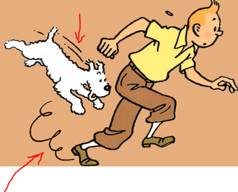
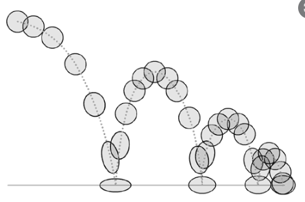
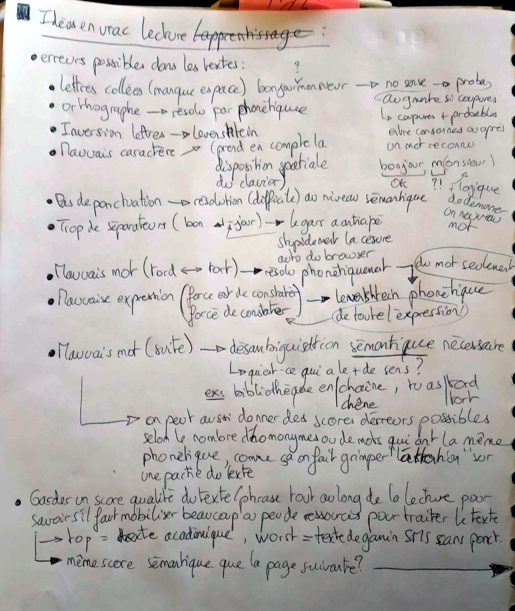
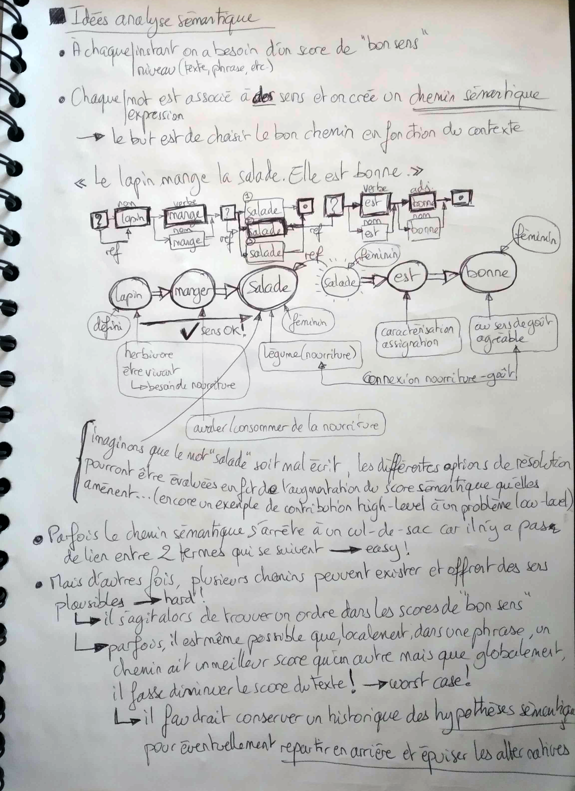
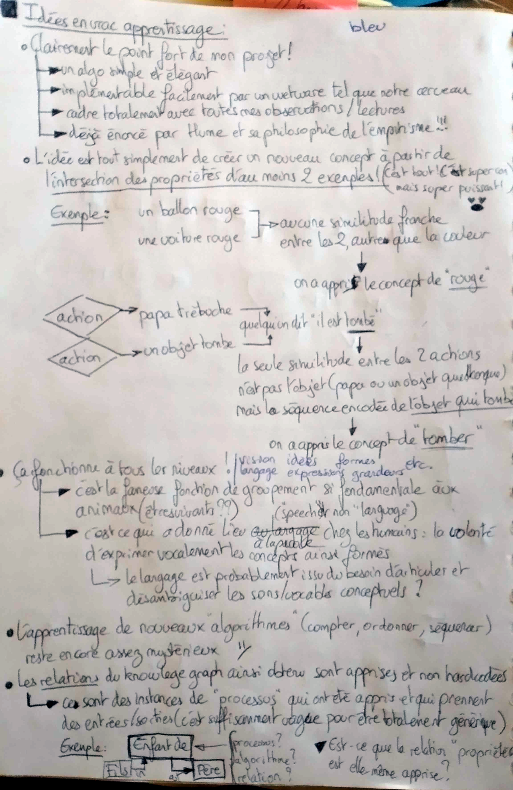
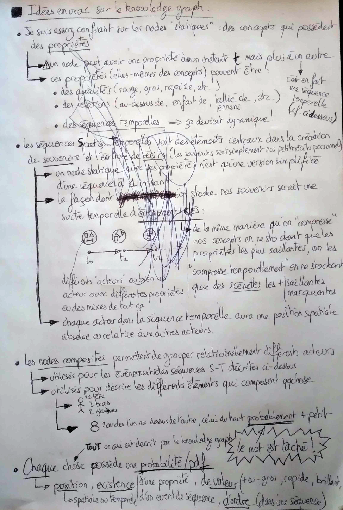
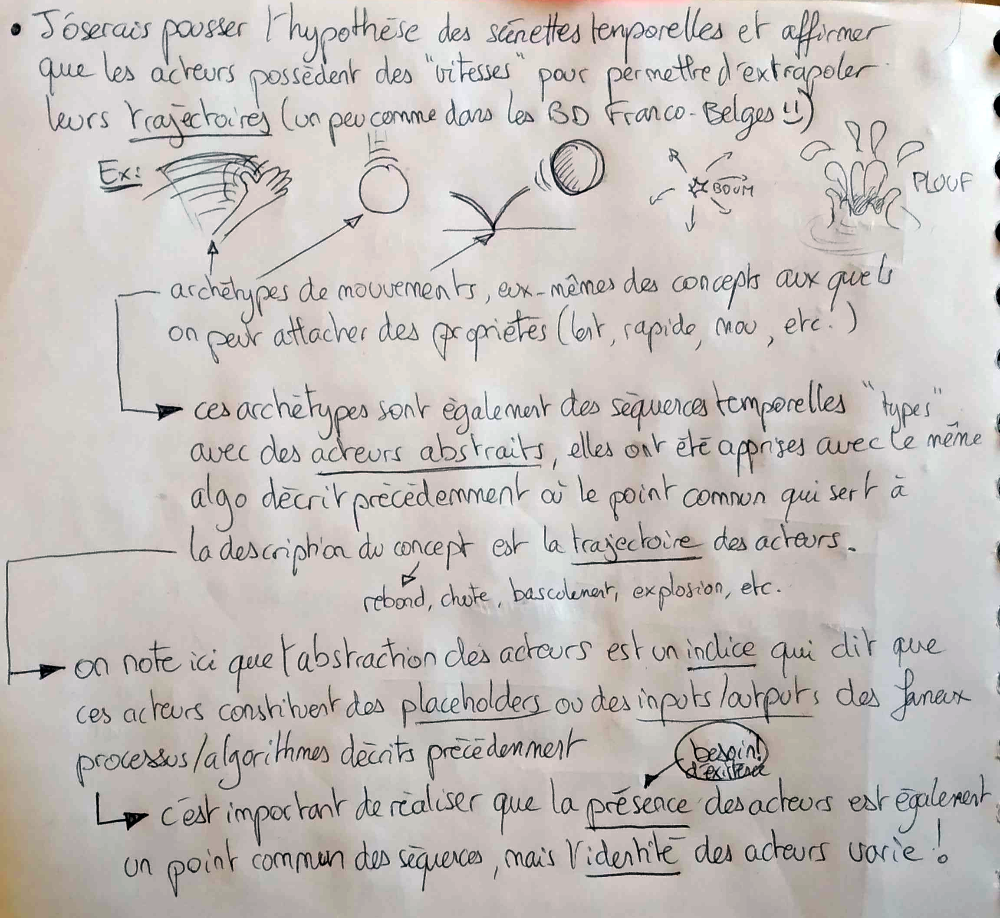


# Apprentissage

Il suffit de moins en moins d'exemples pour apprendre une chose:

* Il suffit de 2 exemples d'une chose (genre regarder 2 chiens) pour apprendre ce qu'est un chien à partir de rien
* Parfois il suffit même d'un seul exemple, si on a déjà le pré-knowledge des êtres vivants puisqu'on "sait" désormais qu'il est plus probable qu'on décrive un être vivant que l'environnement dans lequel il se trouve
	Donc quand un parent montre un chien pour la première fois à son enfant, mais qu'il a déjà vu de nombreux êtres vivants, il est probable que le mot "chien" qu'on essaye de lui apprendre soit acollé à ce nouvel être vivant plus qu'aucune autre chose présente dans le contexte

Reconnaissance lettres:

* On est primed par le fait qu'on va lire du texte, ça "réchauffe" toute la partie reconnaissance de symboles alphabétiques
	* Le simple fait de reconnaître des attributs particuliers de l'écriture (fins arcs et droites connectés) peut lancer le module de reconnaissance d'écriture
* Je pense qu'il faudrait un CNN ou équivalent pour reconnaître droites, arcs et cercles
	* Peu importent les orientations pour l'instant, on veut ressortir une liste de figures avec leur probabilité de reconnaissance
* On redonne ensuite la main au symbolique, ou alors on enchaîne sur un 2nd NN qui gère l'arrangement et les relations entre ces formes
	* Ces formes sont arrangées/collées entre elles et doivent être invariantes à la rotation
	* Le network doit être robuste aux déformations et supporter des représentations de haut niveau
		* Par exemple la lettre "A" peut avoir ou non la barre du A, la lettre "B" c'est surtout 2 arcs collés ensembles (peu importe leur taille relative, jusqu'à un certain point), "C" est un arc seul
		* Les lettres doivent être caractérisées par leurs features centrales:
			* pour le "A", j'aurais tendance à dire qu'il faut que ça soit une arche (2 droites, un U inversé, whatever)
			* Plus on a les caractéristiques d'une lettre (arche + barre > arche toute seule) et plus on est confiants de reconnaître la lettre
			* Moins on a les caractéristiques des autres lettres et plus ça nous aide à contraster et à rejeter les autres possibilités
* Ce 2nd network de reconnaissance de formes est primed par des probabilités de lire certaines lettres
	* De plus en plus certainement qu'on avance dans la lecture du mot
	* Un bel exemple de connexions de guidage symbolique => low level
• Plus on reconnaît de lettres et plus on a une idée de l'orientation du texte
	* On peut reconnaître un "U" jusqu'à ce qu'on réalise que c'est un "A" stylisé à l'envers car d'autres lettres sont reconnues "à l'envers" et que tout à coup les probabilités augmentent si on opère une rotation de tout le texte

> :bulb: **Empirisme Hume** => points communs

Papier à lire pour voir comment ils représentent le nouveau concept à partir de quelques photos
https://textual-inversion.github.io/

## :duck: Discussion "canard" sur #code:

Je vous avais vaguement parlé de l'algo d'apprentissage que je voulais utiliser et qui ressemblait diablement à la doctrine de l'empirisme de Hume que j'avais écoutée chez le Précepteur :sweat_smile: et que je bloquais un peu plus sur la façon d'encoder les relations et les actions entre les différents acteurs de notre monde mental

Mais il s'avère que l'algo d'apprentissage pourrait aussi très bien se prêter à ces relations / actions ! :heart_eyes:

Ca demanderait une structure en code qui serait quasiment pluggable dans tous les sens, bref un truc super vague du style l'objet "Object" en C# duquel tout dérive... :sweat_smile:  
(mais quelque part c'est plutôt bon signe finalement, puisque ça veut dire que le mécanisme de base est ultra simpliste, ce qui est la règle absolue à respecter quand tu essayes de réfléchir à qqchose qui est implémentable par des neurones biologiques)

Depuis un moment je me dis qu'on doit se souvenir des événements comme de petites **scénettes** ordonnées dans le temps, comme des sortes de keyframes...

En gros on se rappelle pas de l'entièreté d'une situation mais de **moments clés**. Et chaque moment clé est une description plus ou moins détaillées de la situation à un instant *t*.

Ca contient des acteurs réels à qui l'on prête 1) des propriétés 2) des positions absolues/relatives et 3) des "vitesses" (je vois ça plutôt comme des petits morceaux de trajectoires, un peu comme dans les BD franco-belges :smile: )

(ça porte un nom mais je sais plus comment s'appellent ces machins)

Que ça soit une course, une rotation, un rebond, une explosion, un plouf, etc. on a des sortes d'archétypes de mouvements imagés de cette manière qui permettent de faire le lien d'une keyframe à l'autre et d'extrapoler le mouvement des acteurs.

Et ces archétypes sont eux-mêmes construits avec une séquence d'events keyframés avec l'objet en question...

 
(peut-être pas aussi détaillé que ça mais bon c'est l'idée)

Mon algo d'apprentissage fonctionne par groupement de choses communes, donc dès qu'on va voir 2 choses rebondir, on va former la notion de séquence de rebond...

Ce qui sera commun, ça sera la forme de la trajectoire des 2 choses qu'on a vues rebondir, mais également (et c'est **là** que c'est très fort !) le fait que ça s'applique à des choses dont la **présence** (l'existence) est obligatoire, mais dont l'**identité** change!

Ca veut dire quoi ?

* Que la trajectoire s'applique à une chose
* Mais que la chose importe peu

Donc le sujet sur lequel s'applique la trajectoire est une **variable** ! Et on vient d'apprendre une **fonction** qui encode une trajectoire !

Et là je viens juste de réaliser qu'on va pouvoir probablement grouper d'autres choses communes applicables sur ces choses qui rebondissent : par exemple le fait qu'elles sont probablement **élastiques** !

Ca veut dire que dès qu'on va rencontrer une chose élastique, on va probablement avoir cette image de trajectoire de rebond qui va venir popper par association !
Donc en gros notre processus va associer une trajectoire de rebond à n'importe quel objet élastique...

Et + tard quand on aura une situation où un objet va rebondir, on va simplement lui assigner une instance de cette fonction décrivant une trajectoire, et cet objet sera la variable d'entrée de la fonction... 
Et + on verra d'exemples d'objets qui rebondissent, plus ça va affiner notre archétype du rebond, de la même manière que plus on va voir d'exemples de chats, plus ça va généraliser notre archétype de chat.

Je trouve ça hyper puissant comme algo ! :star_struck:

> :question:
 Reste à voir si cette notion de **variable** qui proviendrait de la condition d'existence mais de l'absence de la condition d'identité d'une chose peut se transposer à toutes les fonctions qu'on peut vouloir coder ?!

## Scans de mes pages d'idées

> :exclamation:
 TODO: Bongard Problems
 TODO: Parler du fait que tout est guidé par le besoin d'économie d'énergie et que le groupement neuronal participe à cet effort en évitant les gros réseaux et en privilégiant les groupements hiérarchique

[^1]: 
[^2]: 

