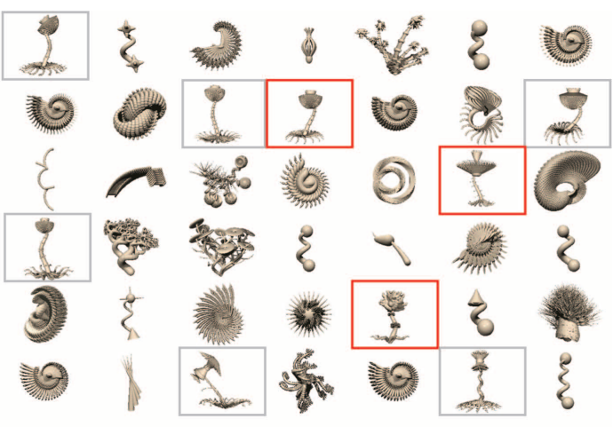

# Les fondements de l'apprentissage

Comment déchiffre-t-on une chose inconnue, un langage, un cryptage, un code secret ?

On commence par trouver des similitudes, des choses qui se ressemblent, des *patterns* réguliers (on pense à la pierre de Rosette de Champolion ou au *"heil Hitler"* des câbles nazis qui ont aidé à leur déchiffrement). Ou bien on cherche des fréquences de tokens qui sortent du lot, des ruptures dans les répétitions : un signal au milieu du bruit.

## Apprentissage Hebbien

Donald Hebb a introduit la règle bien connue "[*cells that fire together wire together*](https://fr.wikipedia.org/wiki/R%C3%A8gle_de_Hebb)".

C'est bien de cela dont il s'agit ici aussi : même au niveau macroscopique des symboles, bien au-dessus du niveau neuronal, les symboles qui s'activent ensemble vont se renforcer.

Pour commencer, on ne peut rien apprendre d'un seul élément : il nous faut forcément un moyen de *comparaison* avec un autre élément du même type.

Si l'on cherche à apprendre la [*qualia*](https://en.wikipedia.org/wiki/Qualia) &#11033;*Rouge*, il va nous falloir 2 choses rouges :

!!! note
    Ici, le nuage désigne une chose qui possède divers *attributs* ou *qualités* représentés par les ellipses, les attributs sont généralement perçus par les sens (domaine concret, de la perception physique) ou conçus par le raisonnement (domaine abstrait, des idées).

Idéalement, les 2 choses à comparer devraient être *les plus orthogonales possibles* et ne se ressembler **que** par le critère qu'on cherche à mémoriser :

* Si les 2 choses sont strictement orthogonales dans **toutes** les dimensions possibles **sauf** la dimension particulière de la qualité qu'on cherche à discerner, alors on a effectivement appris la *qualia* : on a fait du *one-shot learning*.
* En pratique, il est impossible que 2 choses soient dissemblables en tout point sauf un; On doit toujours faire face à un ensemble de critères "parasites" qui vont nous induire en erreur : on va devoir comparer d'autres exemples de choses possédant la qualité à discerner afin départager les bonnes des mauvaises informations.

## En pratique

Voici ce qui se passe communément quand on apprend en examinant une suite d'exemples :

1. La tâche d'apprentissage débute avec l'exemple **(1)** : on ne peut rien apprendre en l'état, puisqu'on n'a aucun point de comparaison
2. On fournit à l'algorithme l'exemple **(2)** :
    * On peut éliminer les percepts **grand, petit, joyeux, méchant** car ils ne sont pas communs aux 2 exemples
    * Les 3 percepts communs entre les 2 exemples sont **chien, doux, rouge** → pour l'instant, la qualia &#11033;*Rouge* = **chien + doux + rouge**
3. On fournit ensuite l'exemple **(3)** :
    * Cette fois-ci, on peut éliminer les percepts **chien, chat**
        * :warning: Mais il est probable que l'algorithme ait appris le concept &#11033;Animal ! Or, **chien** et **chat** ont comme point commun d'être des animaux, ils héritent donc du concept &#11033;Animal.
        * Donc, on peut conserver la qualité d'**animal**, commune à **chien** et **chat**
    * Les percepts communs sont désormais &#11033;*Rouge* = **animal + doux + rouge**
4. On fournit finalement l'exemple **(4)** :
    * On peut enfin éliminer les percepts **doux** et **maison**, ainsi que le concept **animal** puisqu'on voit qu'une maison peut aussi bien faire l'affaire !
        * :warning: Mais il est probable que l'algorithme ait appris le concept &#11033;Objet ! Or **animal** et **maison** ont comme point commun d'être des objets (on notera qu'on peut difficilement remonter à un niveau plus générique et que ça n'est, finalement, pas un mauvais critère du tout pour qualifier &#11033;*Rouge*)
        * Donc, on peut conserver la qualité d'**objet**, commune à **chien, chat** et **maison**
    * Les percepts communs sont désormais &#11033;Rouge = **objet + rouge**

L'algorithme est terminé. Est-il pour autant complet ? Est-ce que la *qualia* &#11033;*Rouge* est effectivement bien représentée par les 2 attributs retenus ? Seul l'avenir le dira, quand on rencontrera de nouveaux exemples de "choses rouges"...

## L'expérience

Il faut bien comprendre que l'algorithme dépeint ci-dessus fonctionne en permanence chez les êtres vivants, il n'y a pas de fin à l'expérience vécue autre que par l'arrêt total de l'organisme.

On va donc affiner notre *croyance* de ce que représente un concept particulier au fur-et-à-mesure de notre expérience dans le monde et de nos rencontres avec les autres êtres vivants et leurs expériences propres.

### La *Confiance*

On s'aperçoit que, contrairement à l'apprentissage profond qui lisse tous les exemples et les agrège en une moyenne comprenant le bon comme le mauvais (les *biais*), notre algorithme ne requiert que très peu d'exemples pour être efficace : il fait du *few-shots learning*.

En contrepartie, il est extrêmement sujet aux **mauvais exemples** ! Surtout au début, où les erreurs de classification peuvent se révéler catastrophiques !

En effet, on ne s'est pas encore posé la question de **qui** (ou **quoi**) fournit les exemples à l'algorithme décrit ci-dessus ?

* Les exemples sont-ils fondés dans le réel ? Sont-ils reçus de notre environnement ? Les a-t-on perçus ou expérimentés nous-mêmes ?
    * Auquel cas, nous sommes forcés de les croire et notre **confiance** est maximale !
    * Les bébés n'ont pas d'autre choix que de croire leurs yeux, leurs oreilles et leur corps quand ils font l'expérience du monde
* Ou bien les exemples nous ont-ils été livrés par un **tuteur** ?
    * Auquel cas, nous ne pouvons leur accorder qu'une **crédence** égale à la **confiance** qu'on place dans le **tuteur**...
    * Les enfants font intrinsèquement confiance aux adultes pour leur communiquer des informations vraies (du moins, aussi vraies que les adultes puissent en juger)

Imaginons qu'un être fourbe ait décidé de nous induire en erreur en nous donnant cette suite d'exemple et en nous assurant qu'il s'agit bien de 2 choses **rouges** :

Catastrophe ! On ne peut plus se raccrocher à aucun point commun, au-delà de la caractéristique **objet** extrêmement générique, qui est vraisemblablement le seul point commun entre ces 2 choses...

### *Backtracking*

Dans le cas d'un empoisonnement des exemples comme ci-dessus, notre unique chance est qu'on se rende compte qu'on possède **déjà** une qualification pour la classe **objet** et que ça n'aurait aucun sens de la requalifier comme **rouge** : un concept est <u>unique</u> ! On ne peut lui associer 2 sens ou 2 noms différents.

On se retrouve donc face à un non-sens. On n'a pas d'autre choix que de revenir en arrière et **réviser notre jugement**.

* Il faut ignorer le ou les exemples qui nous ont conduit à cette impasse

* Il faut également réviser la confiance qu'on a accordée au tuteur qui nous a fourni ces exemples moisis !

    * S'il persévère dans son entreprise de désinformation, on peut même aller jusqu'à ignorer totalement ses informations

        :warning: La pente de "*décrédibilisation*" d'une source doit être très rapide, tandis que la pente de "*re-crédibilisation*" doit être extrêmement lente : il va falloir bien se comporter et pendant très longtemps avant de retrouver le niveau de confiance original ! (certains ne font même plus jamais confiance après une trahison)

Ce genre d'erreurs peuvent en effet s'avérer cruciales dans les premiers temps de l'apprentissage, quand le concept n'est pas encore bien formé et se trouve fortement influencé par les aléas (*critical regime*). Par la suite, quand le concept est bien formé car étayé par de nombreux exemples fiables (*stable regime*), il devient plus aisé de rejeter les mauvais exemples qui s'éloigneraient trop (*outliers*) de notre moyenne d'expérience.

!!! note
    À noter qu'une pression trop forte et surtout persistante de nouveaux exemples proches mais suffisamment éloignés de notre moyenne pourrait signifier un besoin de devoir classifier une nouvelle variété de concept. Il s'agit de juger (sur quels critères ?) s'il est plus aisé d'étendre ou de généraliser notre concept pour accommoder les nouveaux exemples, ou bien s'il est préférable de créer une toute nouvelle catégorie...

### La notion de *prototype*

Cette fameuse *moyenne de nos expériences* s'apparente à la notion de *prototype* inspirée par [la prototype theory](https://en.wikipedia.org/wiki/Prototype_theory) qui a été proposée par [Eleanor Rosch](https://en.wikipedia.org/wiki/Eleanor_Rosch) en 1971.

En effet, contrairement à la spécification Kantienne des concepts qui impose des frontières très *dures* (binaires) d'appartenance ou non à un groupe si et seulement si la chose à apparenter obéit à des conditions nécessaires et suffisantes (par exemple, "une maison **doit** être carrée"), les prototypes permettent une notion floue, presque molle (biologique ?) d'appartenance, et les frontières qui distinguent un groupe d'un autre sont laissées à la subjectivité et au choix de l'observateur.

On renvoie à la note sur la représentativité neuro-symbolique des concepts pour une discussion plus approfondie sur les ["concepts moyens"](ApprocheNeuroSymbolique.md#).

!!! note
    On laissera donc de côté l'approche Kantienne trop rigide pour l'instant, tout en notant qu'elle est à la base de toute réflexion logique et mathématique. On note par avance qu'il est tout à fait possible de construire un système de croyances et de règles extrêmement rigides et rigoureuses basées sur un apprentissage de concepts "mous" et subjectifs. Après tout, Kant était bien un enfant avant d'écrire ses oeuvres ! :grin:

!!! question
     Finalement, on délaisse Kant pour Hume ? :thinking: Allez, fais pas semblant d'avoir lu Kant et Hume ! :roll_eyes:

### Pollution par des évènements de haute-fréquence

Outre la pollution par les mauvais exemples, on va également rencontrer de la pollution par des évènements qui se produisent fréquemment et qui vont par conséquent intervenir souvent dans notre apprentissage.

On pense par exemple au concept &#11033;**Objet** vu plus haut : on le rencontre fréquemment car tous les objets en dérivent, on y arrive donc assez naturellement en remontant la hiérarchie de concepts.

Mais cela arrive dans tous les domaines :

* la fréquence des lettres dans l'alphabet (les 'e' seront beaucoup plus souvent rencontrés que les 'w')
* la fréquence des mots dans une langue (les articles "le" et "la" sont peu significatifs mais extrêmement présents dans les textes)
* la fréquence des phonèmes dans les mots (le [r] dans "**r** ouge" est beaucoup plus prépondérant que [ɲ], dans "bor **gn** e")
* les auxiliaires "être" et "avoir" dans la langue, qui interviennent de manière disproportionnée par rapport aux autre verbes
* les moineaux et les pigeons sont sur-représentés dans la population d'oiseaux auxquels on est généralement confrontés

#### Conséquence

La conséquence naturelle de cette pollution est que :

1. ces éléments fréquents vont souvent faire partie de la qualification de concepts qui n'ont rien à voir et il sera difficile de s'en débarrasser
2. il va être difficile de justement qualifier ces éléments fréquents, puisqu'ils font partie de tant de concepts : comment les définir ?

#### Comment y remédier ?

##### Pondérer l'effet des exemples

Si on peut avoir accès à la fréquence d'occurrence des éléments perturbateurs, on peut par exemple pondérer leur importance par la notion de *[surprise](https://en.wikipedia.org/wiki/Information_content)* 

$s(x)=log(\frac{1}{p(x)})$ où $p(x)$ représente la probabilité d'occurrence de l'élément $x$.

!!! note
    Il est assez facile d'obtenir $p(x)$ dans le cas d'un dataset figé : il suffit de compter les occurrences des éléments qu'on cherche à apprendre et de normaliser le tout, cf. [plus bas](#probabilites).

On voit que le poids à accorder aux éléments sera inversement proportionnel à leur fréquence d'apparition : des éléments peu fréquents vont être très surprenants et apporter beaucoup d'information, tandis que les éléments très fréquents ne transporteront que peux d'information et peuvent donc être ignorés.

!!! remark "Dans la vraie vie..."
    J'ai pu remarquer un exemple assez intéressant quand mon fils a malheureusement appris un mot grossier lorsque j'ai juré après m'être fait mal. La coïncidence des évènements **bruit + papa qui crie + mot grossier** étant (idéalement) peu fréquente, elle a évidemment beaucoup plus d'intérêt que les situations habituelles. Comme l'enfant n'a jamais entendu ce mot auparavant (du moins l'espère-t-on), il va immédiatement y accorder beaucoup d'importance. Et la prochaine fois qu'il l'entendra dans un contexte légèrement différent, par exemple **personne énervée + même mot grossier**, il sera aisé de deviner que les gens disent ce mot dans un contexte d'énervement et qu'il revêt donc un caractère particulier, voire tabou...

##### Soustraire l'influence des éléments communs

Si tant est qu'on ait appris des combinaisons linéaires de notions discrètes, comme c'était le cas plus haut avec le concept &#11033;Rouge = **objet + rouge**, et que l'on soit "miraculeusement" parvenu à enfin isoler l'élément polluant (**objet**, dans le cas de &#11033;Rouge), alors il est tout à fait possible de revenir sur toutes les notions apprises précédemment et de leur **soustraire** l'influence de l'élément polluant : on n'aura alors plus que &#11033;Rouge = **rouge**.

Cela s'appelle simplement "réviser son jugement". Mais attention à la cascade d'évènements que ça peut entraîner ! Est-ce que ces croyances n'étaient pas elles-mêmes à la base d'un édifice plus grand ?

## Apprentissage supervisé

L'algorithme apprendra de manière optimale dans le cas où un <u>tuteur de confiance</u> va fournir des exemples bien choisis.

On a vu que l'important n'est pas spécialement le nombre d'exemples, mais surtout le fait qu'ils soient le plus discriminants et le plus représentatifs possibles.

!!! success "Avantages"
    Si le niveau de confiance dans le tuteur est élevé, l'apprentissage peut se faire de manière très rapide, et chaque information apprise aura un degré de confiance aussi élevé que celui du tuteur.

!!! danger "Inconvénients"
    L'apprentissage supervisé demande beaucoup de temps et d'énergie de la part du tuteur (on pense aux profs qui doivent préparer les cours et les exercices :sweat:).

On distingue plusieurs façons d'apprendre de manière supervisée à partir d'un jeu d'exemples donnés : l'apprentissage direct et l'apprentissage inverse.

### Apprentissage Direct

On donne des exemples où tout est modifié **sauf** l'élément à apprendre.

On va prendre un exemple où l'on veut apprendre comment écrire le mot "chien" en chinois :

1. "Le **chien** est gentil" → **狗** 很好。
2. "Le **chien** mange son repas" → **狗** 吃他的饭。

On voit aisément que le mot "chien" est représenté par le symbole **狗** commun aux 2 exemples

C'est une façon robuste d'apprendre car si la confiance dans le tuteur est grande, il est probable qu'on fasse du *one-shot learning*.

!!! warning
    Dans le cas ci-dessus, il demeure toujours des incertitudes : on ne sait pas s'il y a des variations du symbole chien selon les contextes. Est-ce que le genre et le nombre de chiens importent, comme dans les langues latines ? Est-ce que l'appartenance à un groupe social, ou des notions de politesse influent sur les symboles / mots employés, comme en japonais ? Ce seront autant de leçons supplémentaires qui seront laissées à la charge du tuteur...

### Apprentissage Inverse

Cette fois-ci, on donne des exemples où tout est identique **sauf** les éléments à apprendre.

Par exemple ici :

1. "**La** porte **est rouge**." → 门 **是红色的**。
2. "**La** maison **est rouge**." → 房子 **是红色的**。

On a cette fois appris plus de choses :

* "être *rouge*" ou "avoir la propriété *rouge*" s'écrirait **是红色的**, car c'est la seule partie commune entre les 2 phrases (on a appliqué la méthode d'apprentissage direct).

Ensuite, par **inversion (ou masquage)** de la partie commune entre les 2 phrases ("____ est rouge." → ____ 是红色的。), on peut en déduire le mot et le symbole manquants :

* "porte" s'écrirait **门**, car c'est le mot et le symbole qui manquent, et c'est la seule partie qui change dans la 1ère phrase (on remarque au passage la forme intéressante du symbole)
* "maison" s'écrirait **房子**, car c'est le mot et le symbole qui manquent, et c'est la seule partie qui change dans la 2nde phrase

## Apprentissage non-supervisé

!!! remark "Remarque préalable"
    Est-ce que la notion de supervision a un sens, après tout ? Même en l'absence de supervision humaine, un organisme évoluant dans l'environnement sera toujours soumis aux règles du monde réel : la gravité, la vitesse, la masse, l'inertie, la chaleur, la consistance et la persistance des objets, etc.  D'une certaine manière, l'organisme est toujours supervisé par son environnement et ne peut pas s'en affranchir : chaque action entraîne une réaction aux conséquences perceptibles et mesurables.

On remarque dans le cas d'un apprentissage supervisé qu'on va chercher à *transférer la connaissance* du tuteur vers l'élève.

Tandis que dans le cas d'un apprentissage non-supervisé, on va laisser le modèle apprendre de lui-même dans un cadre donné. Ce cadre comprendra :

* Un ensemble de données desquelles tirer un enseignement
* Un ensemble de règles à respecter
* Un objectif à atteindre

Dans le cas d'un modèle informatique, c'est à la charge du concepteur de préparer les données, les règles et l'objectif à accomplir.

Dans le cas d'un organisme plongé dans l'environnement, les données sont le monde entier et ce que l'organisme en perçoit, les règles sont celles de l'Univers et les limites que le corps de l'organisme lui imposent, l'objectif est indéterminé (se maintenir en vie ? Se reproduire ? Regarder la saison 2 de *Severance* ?).

### Quelques exemples

J'ai écrit quelques notes divers prototypes d'apprentissage non-supervisé :

[Apprentissage des phonèmes](ApprentissagePhonèmes.md)

[Apprentissage de la prononciation de mots inconnus](ApprentissageMotsInconnus.md)

[Apprentissage de la parole](ApprentissageParole.md)

[Apprentissage de la structure des phrases](ApprentissageStructurePhrases.md)

### Notion de certitude

qsd

## Plausibilité biologique

On a vu que les seules choses qui soit réellement nécessaires pour faire fonctionner cet algorithme est d'avoir un mécanisme qui va :

* **Détecter les co-occurrences entre 2 signaux**, ce qui tendrait à indiquer une probable corrélation.

    On sait déjà que ce genre de mécanisme existe partout dans le cerveau, c'est le fameux apprentissage Hebbien dont on a parlé au début.

     

* **Compter les occurrences d'un signal**, ce qui va permettre de calculer son importance relativement aux autres signaux.

    On sait que les neurones biologiques peuvent aisément réagir à des impulsions ou des fréquences d'activation[^1][^2]. Il est donc assez aisé d'imaginer les neurones biologiques réagir à la fréquence d'activation d'un capteur qui va s'éveiller quand il détecte une propriété particulière de l'environnement.

    Même si l'on imagine bien que le cerveau ne vas pas réellement compter les occurrences comme un ordinateur pourrait le faire, il est naturellement câblé pour savoir classifier les ordres de grandeur en utilisant en général 3 catégories, par exemple : { un peu, beaucoup, énormément}, { petit, moyen, grand } ou { faible, moyen, fort }. Et si besoin, en utilisant 5 catégories dont 2 extrêmes : { *minuscule*, petit, moyen, grand, *gigantesque* }.

On notera aussi qu'on distingue facilement la différence entre un groupe de 10 animaux et un groupe de 100 animaux, mais on a plus de mal à distinguer la différence entre un groupe de 100 animaux et un groupe de 110.

Tous ces indices semblent indiquer qu'il est fort plausible qu'un algorithme aussi simple soit une solution de choix pour un organisme vivant : l'algorithme est peu coûteux (il demande peu d'exemples), facile à mettre en oeuvre (il demande une structure neuronale simple) et est très versatile (il s'applique à de nombreux problèmes symboliques) !

En comparaison, la *backpropagation* semble peu probable biologiquement autrement que dans sa version la plus basique qui consiste à renforcer ou détruire les connexions selon qu'elles sont beaucoup ou peu sollicitées...

### Probabilités

Si nécessaire et dans le cas d'un comptage d'occurrences exact par la machine, on peut facilement obtenir les probabilités d'occurrences de chaque signal en normalisant le nombre d'occurrences du signal par le nombre total d'occurrences de tous les signaux :

* Prenons l'exemple de la phrase "**le chat saute sur la table**."
* Comptons le nombre d'occurrences de chaque lettre :
    * l = 3, e = 3, c = 1, h = 1, a = 4, t = 3, s = 2, u = 2, r = 1, b = 1
* Le nombre total d'occurrences est 3 + 3 +1 + 1 + 4 + 3 + 2 + 2 + 1 + 1 = 21 (le nombre de lettres dans la phrase)
* On obtient donc les probabilités d'occurrence de chaque lettre, par ordre décroissant :
    * $p(a) = 4/21$,
    * $p(l) = p(e) = p(t) = 3/21$
    * $p(s) = p(u) = 2/21$
    * $p(c) = p(h) = p(r) = p(b) = 1/21$

### Peut-on tout apprendre avec cet algorithme ?

Dans [la note sur l'approche neuro-symbolique](ApprocheNeuroSymbolique.md/#peut-on-utiliser-notre-algorithme-dapprentissage-pour-entrainer-ces-reseaux-interfaces), on souligne le fait que cet algorithme est plutôt destiné à être employé sur des données symboliques et qu'il est préférable de continuer d'utiliser les réseaux de neurones profonds actuels et la *backpropagation* pour tout ce qui concerne l’interfaçage avec l'environnement : ils ont fait leur preuve et démontré qu'ils constituaient le chaînon manquant dans la recherche en IA depuis toutes ces années.

On aimerait tout de même trouver des améliorations comme :

* Plus de plasticité neuronale : on voudrait pouvoir faire évoluer la structure du réseau de neurones, renforcer les connexions utiles et réduire les connexions inutiles
* Trouver une façon de faire évoluer le réseau de neurones pour accommoder de nouvelles catégories symboliques (ça rejoint un peu la plasticité neuronale)
* Faire en sorte que ces réseaux aient des connexions *top → down* qui permettraient à l'étage symbolique de préparer (*prime*) le réseau à réagir à certaines *features* que l'on sait qu'elles vont intervenir avec une grande probabilité, par exemple un ensemble de phonèmes probables parce qu'on a entendu les premiers phonèmes d'un mot, ou un ensemble de mots probables parce qu'on a lu le début de la phrases (*auto-complete*).

### Dans la vie de tous les jours

Dans notre vie quotidienne, nous conservons un état du monde à un moment donné qui peut partir de l'endroit où on a laissé nos clés de voiture dans la maison et s'étendre jusqu'à l'état de la géopolitique mondiale, en passant par de nombreux niveaux de détail auxquels ont va accorder plus ou moins d'importance selon qu'ils nous affectent directement ou non.

L'algorithme d'apprentissage peut être observé dans de nombreuses situations :

* Dans la classification d'un danger, d'une douleur ou d'un état indésirable en présence d'un élément particulier → on va associer de la gêne ou de la prudence à la présence de cet élément

    (ça peut être plus difficile à mettre en évidence quand il y a un délai trop long entre l'action et la réaction, par exemple dans le cas d'un empoisonnement alimentaire, ou la conception d'un enfant)

* Dans l'apprentissage d'une langue par l'écrit → on a vu comment ça ce passe pour le chinois

* Dans l'apprentissage d'une langue par la vision où l'on nous montre un objet et on nous écrit / on nous dit le mot qui le représente → on fait l'association objet / mot qu'on va mémoriser

* Dans l'apprentissage des lois de la physique, quand on va lier certains effets à certaines causes, comme par exemple le fait que certains objets cassent parce qu'ils sont dans des matériaux fragiles comme le verre, la céramique, etc.

* Dans l'apprentissage des analogies, quand on va pouvoir transposer certaines situations à d'autres parce qu'une certaine hiérarchie de propriétés sont "allumées" dans les 2 cas

**Questions en suspens**

Vision ? Audio ? Planning ? 

Est-ce limité à des variables booléennes ? (propriétés / features d'un objet) ==> cf. note sur la représentation conceptuelle

La question est : comment généralise-t-on ça aux actions et aux procédures ? À la planification (réentrance, récursion) ? À la structuration hiérarchique de concepts, et pas juste à des séquences ?

### 

### *Attention is all you need*

Pour avoir observé mon fils de 4 ans apprendre de son environnement et de ses parents, je me suis rendu compte que s'ils n'avaient pas un *attention span* limité à 4.3 secondes et s'il ne manifestaient pas parfois la volonté la plus tenace à vouloir faire l'inverse de ce qu'on leur demande, les enfants seraient capables d'apprendre et maîtriser des concepts avancés très rapidement et aussi bien qu'une machine ! :sweat_smile:

Comment les objets tombent ? Pourquoi ils rebondissent ? Pourquoi ça fait ce bruit ? Est-ce que ça casse ? Comment ça se démonte ? Quel goût ça a ? Hé mais ça pique ! Oulah trop chaud ! Et si je fais ça, ça fait quoi ? Ouvrir, fermer, ouvrir, fermer, ... ? Bah bah bah bah mah mah mah ?

Les bébés et les jeunes enfants passent leur temps à *répéter* des actions encore et encore ! Ils testent des hypothèses en permanence et s'imprègnent du *feedback* de l'environnement constamment !

Ils font des corrélations entre action et réaction en éprouvant la physique et la communication sans arrêt !

### *...and perfect memory too*

Mais en plus de mobiliser notre attention, il nous faut aussi de la mémoire et une bonne plasticité synaptique pour se rappeler des leçons qu'on a apprises !

Les machines ont donc un avantage considérable sur nous puisqu'elles peuvent mobiliser 100% de leur attention sur une tâche en permanence et mémoriser parfaitement les informations !

## Combien "coûte" cet algorithme ?

Si l'on se décide à effectivement faire le découpage "*deep neural nets* pour l'interfaçage avec environnement" et "apprentissage symbolique pour le raisonnement", alors il est vraisemblable que les coûts d'entraînement des IA vont baisser drastiquement :

* Les coûts d'entraînement des réseaux d'interfaçage seront grosso modo les mêmes que ceux des réseaux de vision / génération d'image actuels, sans la couche de langage
* Le coût d'entraînement de la couche de raisonnement symbolique est quant à lui extrêmement réduit : pas besoin de milliards de données ni même de GPUs pour les traiter !

## Travaux semblables

Tenenbaum et ses "tufas" [^3]

[^1]: 2024, Kirsanov A., ["How your brain chooses to remember"](https://www.youtube.com/watch?v=ceFFEmkxTLg&ab_channel=ArtemKirsanov)
[^2]: 2024, Yang W. et al. ["Selection of experience for memory by hippocampal sharp wave ripples"](https://www.science.org/doi/10.1126/science.adk8261) ([site](https://winnieyangwannan.github.io/RippleTagging/projects/1_project/)) ([notebook](https://colab.research.google.com/drive/1qwruNxqS20xIl7sXYwjUA5zXKLTMWuTz?usp=drive_link))
[^3]: 2011, Tenenbaum J. ["How to Grow a Mind: Statistics, Structure, and Abstraction"](https://cocosci.princeton.edu/tom/papers/LabPublications/GrowMind.pdf)
